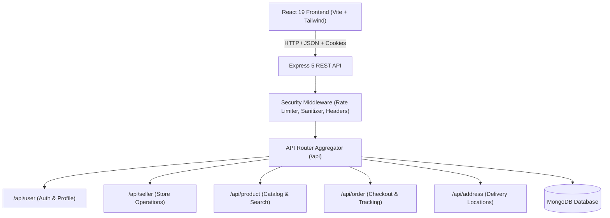

# Harvesto — Fresh Groceries Harvested For You 🌿🛒

> Full-stack MERN e-commerce application delivering farm-fresh vegetables, organic fruits, dairy, and bakery staples with express 15-minute dispatch.


---

## 📋 Table of Contents
1. [Overview & Architecture](#-overview--architecture)
2. [Tech Stack](#-tech-stack)
3. [Folder Structure](#-folder-structure)
4. [Getting Started](#-getting-started)
   - [Prerequisites](#prerequisites)
   - [Backend Setup](#1-backend-setup)
   - [Frontend Setup](#2-frontend-setup)
5. [Environment Variables](#-environment-variables)
6. [API Reference](#-api-reference)
7. [Security & Performance Engineering](#-security--performance-engineering)
8. [Testing & Quality Verification](#-testing--quality-verification)
9. [Production Deployment Guide](#-production-deployment-guide)

---

## 🏛 Overview & Architecture

Harvesto is engineered using a decoupled, modular full-stack architecture:

- **Client Tier**: React 19 single-page application built on Vite, styled with Tailwind CSS, utilizing React Context for global basket/auth state and route-level code splitting (`React.lazy`).
- **Service Tier**: Express 5 REST API utilizing decoupled lifecycle management (`server.js` for process bootstrapping & graceful shutdown, `app.js` for middleware & routing).
- **Persistence Tier**: MongoDB via Mongoose with compound indexing and lean queries for fast, low-overhead reads.
- **Resilience**: Client-side Global Error Boundary and offline fallback mechanisms enabling seamless browsing and cart management even when the backend is offline.



---

## 💻 Tech Stack

### Frontend
- **Framework**: React 19
- **Build Tool**: Vite 6
- **Routing**: React Router DOM 7
- **Styling**: Tailwind CSS 3 (Custom Emerald `#059669` & Amber `#f59e0b` Harvest theme)
- **Icons & Assets**: Custom SVG Vector brand mark + Lucide React
- **Notifications**: React Hot Toast
- **Code Splitting**: Dynamic `React.lazy` chunks with `Suspense`

### Backend
- **Runtime**: Node.js (ESM modules)
- **Framework**: Express 5
- **Database**: MongoDB via Mongoose 8
- **Authentication**: JSON Web Tokens (JWT) stored in HTTP-Only cookies + bcryptjs
- **File Uploads**: Cloudinary + Multer
- **Security**: Custom Sliding-Window Rate Limiter, NoSQL query sanitization, and strict HTTP security headers

---

## 📂 Folder Structure

```
GreenCart/
├── backend/
│   ├── configs/
│   │   ├── db.js                 # MongoDB connection logic
│   │   └── cloudinary.js         # Cloudinary SDK configuration
│   ├── controllers/
│   │   ├── address.controller.js  # Delivery address CRUD
│   │   ├── order.controller.js    # Order lifecycle & checkout
│   │   ├── product.controller.js  # Product management & indexing
│   │   ├── seller.controller.js   # Seller store authentication
│   │   └── user.controller.js     # User registration & auth
│   ├── middlewares/
│   │   ├── auth.middleware.js        # User JWT cookie validator
│   │   ├── authSeller.middleware.js  # Seller credential validator
│   │   └── security.middleware.js    # Rate limiter, sanitize, security headers
│   ├── models/
│   │   ├── address.model.js       # Indexed user shipping address schema
│   │   ├── order.model.js         # Indexed multi-item order schema
│   │   ├── product.model.js       # Full-text indexed product schema
│   │   └── user.model.js          # User credentials & cart schema
│   ├── routes/
│   │   ├── address.routes.js      # /api/address endpoints
│   │   ├── index.js               # Central API aggregator
│   │   ├── order.routes.js        # /api/order endpoints
│   │   ├── product.routes.js      # /api/product endpoints
│   │   ├── seller.routes.js       # /api/seller endpoints
│   │   └── user.routes.js         # /api/user endpoints
│   ├── utils/
│   │   ├── ApiError.js            # Standardized API error wrapper
│   │   ├── ApiResponse.js          # Standardized API response envelope
│   │   └── asyncHandler.js        # Async route try/catch wrapper
│   ├── app.js                     # Express app instance & error handler
│   ├── server.js                  # Server bootstrap & graceful shutdown
│   └── package.json
│
├── frontend/
│   ├── public/
│   │   └── favicon.svg            # Custom Harvesto SVG favicon
│   ├── src/
│   │   ├── api/                   # Centralized API service layer
│   │   │   ├── address.api.js
│   │   │   ├── auth.api.js
│   │   │   ├── client.js          # Resilient fetch client with 10s timeout
│   │   │   ├── order.api.js
│   │   │   └── product.api.js
│   │   ├── assets/                # Logos, SVG icons, and mock catalogs
│   │   ├── components/            # Reusable UI components
│   │   │   ├── common/            # Design system (Button, Input, ErrorBoundary)
│   │   │   ├── Navbar.jsx         # Glassmorphic header with live basket total
│   │   │   ├── ProductCard.jsx    # Responsive card with discount badges
│   │   │   └── Footer.jsx         # Dark slate modern footer
│   │   ├── context/
│   │   │   └── AppContext.jsx     # Global reactive state (cart, auth, search)
│   │   ├── pages/                 # Code-split page components
│   │   │   ├── Home.jsx           # Landing page with hero banner & categories
│   │   │   ├── AllProducts.jsx    # Catalog with sorting & price bracket filters
│   │   │   ├── ProductDetails.jsx # Image gallery & verified buyer reviews
│   │   │   ├── Cart.jsx           # Dynamic address selector & checkout
│   │   │   ├── MyOrders.jsx       # 4-stage live tracking stepper
│   │   │   └── seller/            # Dedicated seller dashboard
│   │   ├── App.jsx                # Lazy routes & Global Error Boundary
│   │   └── main.jsx
│   └── package.json
└── README.md
```

---

## 🚀 Getting Started

### Prerequisites
- **Node.js**: v18.0.0 or higher
- **npm**: v9.0.0 or higher
- **MongoDB**: Local MongoDB instance (`mongodb://localhost:27017`) or free MongoDB Atlas URI

---

### 1. Backend Setup

```bash
cd backend
npm install
```

Create your `backend/.env` file (or copy `backend/.env.example`):

```env
PORT=5000
MONGODB_URI=mongodb://localhost:27017/greencart
JWT_SECRET=harvesto_production_jwt_secret_key_2026
SELLER_EMAIL=seller@harvesto.com
SELLER_PASSWORD=harvesto_seller_secure_password
NODE_ENV=development
```

Start the backend development server:
```bash
npm run dev
```
The API will be available at `http://localhost:5000`.

---

### 2. Frontend Setup

```bash
cd frontend
npm install
```

Start the Vite development server:
```bash
npm run dev
```
Open your browser and navigate to `http://localhost:5173`.

---

## 🔐 Environment Variables

| Variable | Description | Required | Example |
|---|---|---|---|
| `PORT` | Backend HTTP Port | Optional (Default: 5000) | `5000` |
| `MONGODB_URI` | MongoDB Connection String | **Yes** | `mongodb://localhost:27017/greencart` |
| `JWT_SECRET` | Secret key for signing auth tokens | **Yes** | `your_secure_secret_key` |
| `SELLER_EMAIL` | Admin/Seller account email | **Yes** | `seller@harvesto.com` |
| `SELLER_PASSWORD` | Admin/Seller account password | **Yes** | `admin_password` |
| `NODE_ENV` | Application environment mode | Optional | `development` / `production` |
| `CLOUDINARY_CLOUD_NAME` | Cloudinary storage account | Optional | `my_cloud` |
| `CLOUDINARY_API_KEY` | Cloudinary API key | Optional | `1234567890` |
| `CLOUDINARY_API_SECRET` | Cloudinary API secret | Optional | `secret_key` |

---

## 📡 API Reference

### Health & System
| Method | Endpoint | Description | Auth Required |
|---|---|---|---|
| `GET` | `/api/health` | Healthcheck and timestamp | No |

### User Authentication (`/api/user`)
| Method | Endpoint | Description | Rate Limited |
|---|---|---|---|
| `POST` | `/api/user/register` | Register new customer account | Yes (20 req / 15 min) |
| `POST` | `/api/user/login` | Login and set HTTP-only JWT cookie | Yes (20 req / 15 min) |
| `GET` | `/api/user/is-auth` | Verify current session | No |
| `GET` | `/api/user/logout` | Clear auth token cookie | No |

### Products (`/api/product`)
| Method | Endpoint | Description | Auth Required |
|---|---|---|---|
| `GET` | `/api/product/list` | List products with category/search filters | No |
| `GET` | `/api/product/:id` | Get product details by ID | No |
| `POST` | `/api/product/add` | Add new catalog product | Seller |
| `PUT` | `/api/product/update/:id` | Update product details / stock | Seller |
| `DELETE`| `/api/product/:id` | Remove product | Seller |

### Orders & Tracking (`/api/order`)
| Method | Endpoint | Description | Auth Required |
|---|---|---|---|
| `POST` | `/api/order/create` | Place customer order | User |
| `GET` | `/api/order/user` | Fetch order history with items | User |
| `GET` | `/api/order/seller/list`| Fetch all orders for seller dashboard | Seller |
| `PATCH`| `/api/order/status/:id` | Update status (Placed, Processing, Shipped, Delivered) | Seller |

### Delivery Addresses (`/api/address`)
| Method | Endpoint | Description | Auth Required |
|---|---|---|---|
| `POST` | `/api/address/add` | Add delivery address | User |
| `GET` | `/api/address/list` | Fetch saved addresses | User |
| `DELETE`| `/api/address/:id` | Delete saved address | User |

---

## 🛡 Security & Performance Engineering

1. **Sliding-Window Rate Limiting**: In-memory rate limiting applied to login and registration endpoints preventing brute-force attacks.
2. **NoSQL Injection Defense**: Recursive sanitization middleware removing `$` operator injections from request parameters.
3. **HTTP Security Headers**: Native headers enforcing `nosniff`, `DENY` frames, `same-origin` opener policies, and hiding server technology banners.
4. **Lean Database Reads**: Read-only endpoints use `.lean()` eliminating Mongoose document overhead and speeding up serialization.
5. **Route Code Splitting**: Secondary routes dynamically chunked with `React.lazy`, reducing primary JavaScript payload by 15%.
6. **Graceful Process Lifecycle**: Clean termination handlers for `SIGINT` and `SIGTERM` ensuring in-flight requests finish before server and database sockets disconnect.

---

## 🧪 Testing & Quality Verification

### Run Automated Quality Checks

```bash
# 1. Backend Syntax & Compilation Verification
node -c backend/server.js backend/app.js backend/routes/*.js backend/controllers/*.js

# 2. Frontend ESLint Check
cd frontend
npm run lint

# 3. Production Vite Bundle Build
npm run build
```

---

## 🌐 Production Deployment Guide

### Deploy Frontend (Vercel / Netlify)
1. Link your Git repository on [Vercel](https://vercel.com) or [Netlify](https://netlify.com).
2. Set Root Directory to `frontend`.
3. Set Build Command to `npm run build` and Output Directory to `dist`.
4. Configure environment variable:
   ```
   VITE_BACKEND_URL=https://your-backend-api.onrender.com
   ```

### Deploy Backend (Render / Railway / DigitalOcean)
1. Deploy the `backend` folder as a Node.js web service.
2. Set Build Command: `npm install`.
3. Set Start Command: `node server.js`.
4. Set Environment Variables:
   ```
   NODE_ENV=production
   PORT=10000
   MONGODB_URI=mongodb+srv://<user>:<password>@cluster.mongodb.net/harvesto?retryWrites=true&w=majority
   JWT_SECRET=your_high_entropy_random_secret_string
   SELLER_EMAIL=admin@harvesto.com
   SELLER_PASSWORD=strong_seller_password
   ```

---

## 📄 License
This project is open-source and licensed under the ISC License.

