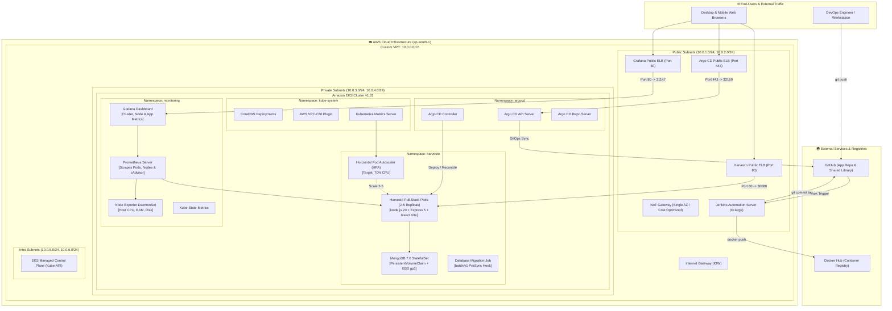
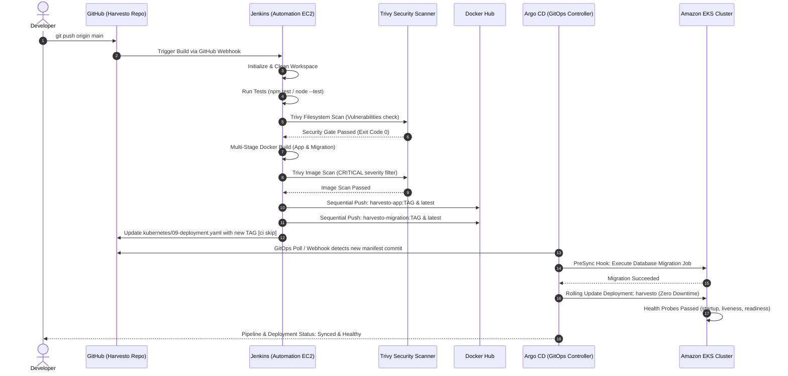

# 🏛️ Harvesto Enterprise Architecture & System Design

Harvesto is a cloud-native, enterprise-grade e-commerce microservices and web platform deployed on Amazon Web Services (AWS) using modern DevOps, GitOps, and Site Reliability Engineering (SRE) paradigms.

---

## 1. High-Level Architectural Topology

---

## 2. Infrastructure as Code (Terraform) Blueprint

| Component | AWS Resource | Specification / Configuration |
| :--- | :--- | :--- |
| **VPC** | `aws_vpc` | CIDR: `10.0.0.0/16`, DNS Hostnames & Support enabled |
| **Public Subnets** | `aws_subnet` | `10.0.1.0/24`, `10.0.2.0/24` (Auto-assign public IP) |
| **Private Subnets** | `aws_subnet` | `10.0.3.0/24`, `10.0.4.0/24` (Worker nodes isolate internet ingress) |
| **Intra Subnets** | `aws_subnet` | `10.0.5.0/24`, `10.0.6.0/24` (Control plane communication) |
| **NAT Gateway** | `aws_nat_gateway` | Single NAT Gateway with Elastic IP in `ap-south-1a` for egress updates |
| **EKS Control Plane** | `aws_eks_cluster` | Kubernetes version `1.31`, public/private API endpoint access |
| **Managed Node Group**| `aws_eks_node_group` | Instance type: `t3.large`, SPOT capacity, Min: 2, Desired: 2, Max: 3 |
| **Security Groups** | `aws_security_group` | NodePort range `30000-32767` explicitly allowed from VPC & ELB |

---

## 3. DevSecOps CI/CD Pipeline Architecture

---

## 4. Kubernetes Resource Layout

* **Namespace: `harvesto`**
  * `01-namespace.yaml`: Enforces logical multi-tenant isolation.
  * `02-mongodb-pv.yaml` & `03-mongodb-pvc.yaml`: Persistent volume claim for database storage.
  * `04-configmap.yaml` & `05-secrets.yaml`: Decoupled runtime configuration and credentials.
  * `06-mongodb-service.yaml`: ClusterIP service (`mongodb-service:27017`).
  * `07-mongodb-statefulset.yaml`: Single replica MongoDB 7.0 stateful engine.
  * `08-migration-job.yaml`: PreSync lifecycle hook for database schema and seed updates.
  * `09-deployment.yaml`: RollingUpdate Deployment (2 replicas minimum, container port 5000).
  * `10-service.yaml`: Public AWS LoadBalancer service (Port 80 -> NodePort 30080).
  * `11-hpa.yaml`: Horizontal Pod Autoscaler scaling from 2 to 5 pods when CPU exceeds 70%.

---

## 5. Network Routing & Port Mapping Matrix

| Service | Protocol | External Port | NodePort | Container Port | Security Boundary |
| :--- | :--- | :--- | :--- | :--- | :--- |
| **Harvesto Web App** | HTTP | `80` | `30080` | `5000` | Internet Facing via AWS ELB |
| **Argo CD UI** | HTTPS | `443` | `32169` | `8080` (TLS) | Internet Facing via AWS ELB |
| **Grafana Dashboard** | HTTP | `80` | `31147` | `3000` | Internet Facing via AWS ELB |
| **Prometheus Server** | HTTP | `9090` | `32058` | `9090` | Internet Facing via AWS ELB |
| **Jenkins Automation**| HTTP | `8080` | N/A | Host `8080` | EC2 Public Subnet SG (0.0.0.0/0) |
| **MongoDB Service** | TCP | N/A | None | `27017` | Cluster-Internal Only (ClusterIP) |
