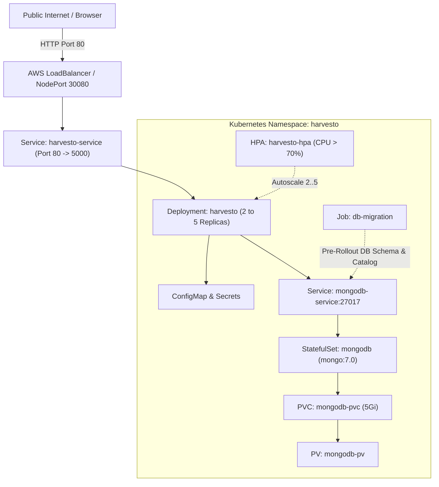

# Harvesto — Kubernetes Production Manifests (Domain-Free / Direct Access)

This directory contains the production-ready Kubernetes manifests for deploying the Harvesto application, MongoDB persistence layer, automated database migration runner, and auto-scaler on AWS EKS or any standard Kubernetes cluster.

---

## 🏛️ Architecture Overview (No Custom Domain Required)

Because a custom domain and cert-manager SSL issuer are not configured, external traffic routes directly through the **Kubernetes Service** (`harvesto-service`):
- **Cloud (AWS EKS)**: The Service is configured as `type: LoadBalancer`. AWS automatically provisions an external Network / Classic Load Balancer with a public DNS hostname (e.g. `http://a1b2c3d4.ap-south-1.elb.amazonaws.com`).
- **Bare-Metal / Minikube / On-Premise**: The Service binds to `nodePort: 30080` (accessible at `http://<Node-IP>:30080`).
- **Developer Local Access**: Direct port-forwarding via `kubectl port-forward svc/harvesto-service 5000:80`.



---

## 📁 Manifest Catalog & Execution Order

All manifests are numbered sequentially for deterministic, dependency-safe rollout:

| Order | File | Kind | Description |
| :---: | :--- | :--- | :--- |
| **01** | [`01-namespace.yaml`](./01-namespace.yaml) | `Namespace` | Creates the isolated `harvesto` namespace. |
| **02** | [`02-mongodb-pv.yaml`](./02-mongodb-pv.yaml) | `PersistentVolume` | Allocates 5Gi persistent disk storage for MongoDB database files. |
| **03** | [`03-mongodb-pvc.yaml`](./03-mongodb-pvc.yaml) | `PersistentVolumeClaim` | Requests and binds the 5Gi storage volume within `harvesto` namespace. |
| **04** | [`04-configmap.yaml`](./04-configmap.yaml) | `ConfigMap` | Non-sensitive runtime variables (`MONGODB_URI`, `PORT=5000`, `NODE_ENV=production`). |
| **05** | [`05-secrets.yaml`](./05-secrets.yaml) | `Secret` | Sensitive credentials (`JWT_SECRET`). |
| **06** | [`06-mongodb-service.yaml`](./06-mongodb-service.yaml) | `Service` | Internal headless/ClusterIP service exposing MongoDB on port 27017. |
| **07** | [`07-mongodb-statefulset.yaml`](./07-mongodb-statefulset.yaml) | `StatefulSet` | High-availability MongoDB 7.0 database pod with volume mount at `/data/db`. |
| **08** | [`08-migration-job.yaml`](./08-migration-job.yaml) | `Job` | One-off batch Job running database indexes and initial catalog seed before app traffic. |
| **09** | [`09-deployment.yaml`](./09-deployment.yaml) | `Deployment` | RollingUpdate deployment for the Harvesto fullstack app (2 replicas, health probes). |
| **10** | [`10-service.yaml`](./10-service.yaml) | `Service` | External `LoadBalancer` exposing port 80 (targets 5000) and `nodePort: 30080`. |
| **11** | [`11-hpa.yaml`](./11-hpa.yaml) | `HorizontalPodAutoscaler` | Automatically scales application pods from 2 to 5 based on 70% CPU threshold. |

---

## 🚀 Step-by-Step Deployment Guide

### Step 1: Deploy Core Configuration & Persistence
```bash
# 1. Create the namespace
kubectl apply -f 01-namespace.yaml

# 2. Allocate storage
kubectl apply -f 02-mongodb-pv.yaml
kubectl apply -f 03-mongodb-pvc.yaml

# 3. Apply configurations & credentials
kubectl apply -f 04-configmap.yaml
kubectl apply -f 05-secrets.yaml
```

### Step 2: Deploy MongoDB & Wait for Readiness
```bash
# 4. Deploy MongoDB Service and StatefulSet
kubectl apply -f 06-mongodb-service.yaml
kubectl apply -f 07-mongodb-statefulset.yaml

# 5. Wait for MongoDB pod to become fully ready
kubectl rollout status statefulset/mongodb -n harvesto --timeout=120s
```

### Step 3: Run Database Migrations
```bash
# 6. Trigger schema indexing & initial catalog seeding
kubectl apply -f 08-migration-job.yaml

# 7. Verify job completion
kubectl wait --for=condition=complete job/db-migration -n harvesto --timeout=120s
kubectl logs -n harvesto job/db-migration
```

### Step 4: Deploy Application & LoadBalancer Service
```bash
# 8. Deploy Harvesto app and external Service
kubectl apply -f 09-deployment.yaml
kubectl apply -f 10-service.yaml

# 9. Deploy Horizontal Pod Autoscaler
kubectl apply -f 11-hpa.yaml

# 10. Verify rollout status
kubectl rollout status deployment/harvesto -n harvesto --timeout=180s
```

---

## 🌐 Accessing the Application Without a Domain

### Option A: AWS EKS External LoadBalancer (Production)
Run:
```bash
kubectl get svc harvesto-service -n harvesto
```
Look for the `EXTERNAL-IP` column:
```
NAME               TYPE           CLUSTER-IP      EXTERNAL-IP                                       PORT(S)
harvesto-service   LoadBalancer   172.20.45.12    k8s-harvesto-123456789.ap-south-1.elb.amazonaws.com   80:30080/TCP
```
Open **`http://<EXTERNAL-IP>`** in your browser.

---

### Option B: NodePort Access (Direct Node IP)
If running on bare-metal, EC2 worker node directly, or Minikube:
```bash
# Retrieve public or internal Node IP
kubectl get nodes -o wide
```
Open **`http://<NODE-PUBLIC-IP>:30080`** in your browser.

---

### Option C: Kubectl Port-Forwarding (Local Debugging)
```bash
kubectl port-forward svc/harvesto-service -n harvesto 5000:80
```
Open **`http://localhost:5000`** in your browser.

---

## 🔍 Diagnostic & Troubleshooting Commands

```bash
# View all running resources in harvesto namespace
kubectl get all -n harvesto

# Stream application logs
kubectl logs -n harvesto -l app=harvesto -f --tail=100

# View detailed events if pod is crashing or pending
kubectl describe pod -n harvesto -l app=harvesto

# Check database migration logs
kubectl logs -n harvesto job/db-migration

# Check HPA scaling status
kubectl get hpa -n harvesto
```

---

## 🧹 Teardown / Cleanup Commands
To cleanly delete all Harvesto resources from your cluster:
```bash
kubectl delete namespace harvesto
kubectl delete pv mongodb-pv
```
