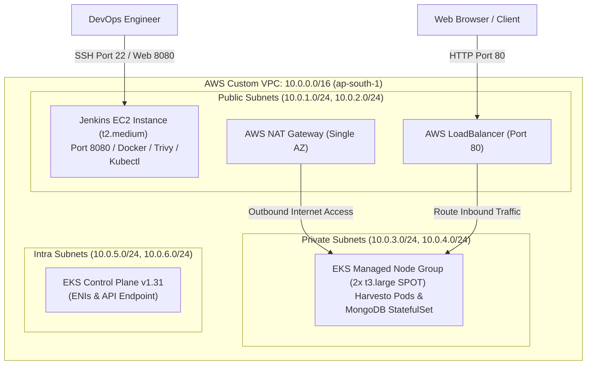

# Harvesto Infrastructure as Code (Terraform on AWS)

This directory provides the production-grade Infrastructure as Code (IaC) for provisioning the entire Harvesto cloud environment in the AWS **`ap-south-1` (Mumbai)** region.

---

## 🏛️ Architecture Overview

The infrastructure provisions a secure, multi-tier VPC network, an Amazon EKS Kubernetes cluster for microservices and database workloads, and an automated Jenkins automation server (EC2) bootstrapped with essential DevOps tools.



---

## 📁 File Structure & Responsibilities

| File | Purpose |
| :--- | :--- |
| [`terraform.tf`](./terraform.tf) | Specifies minimum Terraform version (`>= 1.5.0`) and the official AWS provider (`~> 6.0`). |
| [`provider.tf`](./provider.tf) | Configures the AWS provider region (`ap-south-1`), local variables, CIDR blocks, and global resource tags. |
| [`variables.tf`](./variables.tf) | Declares customizable parameters (region, instance type, cluster name, and dynamic Ubuntu AMI lookup). |
| [`vpc.tf`](./vpc.tf) | Provisions the custom VPC across 2 Availability Zones (`ap-south-1a`, `ap-south-1b`) with public, private, and intra subnets plus NAT Gateway. |
| [`eks.tf`](./eks.tf) | Deploys Amazon EKS v1.31 with CoreDNS, Kube-Proxy, VPC-CNI addons, and a managed Spot worker node group (`t3.large`). |
| [`ec2.tf`](./ec2.tf) | Launches the Jenkins EC2 instance inside the VPC public subnet with automated security groups and SSH key pair. |
| [`install_tools.sh`](./install_tools.sh) | User-data bootstrap script that installs OpenJDK 21, Jenkins, Docker, Trivy, Kubectl v1.31, Helm v3, and AWS CLI v2. |
| [`outputs.tf`](./outputs.tf) | Exports useful endpoints: VPC ID, EKS endpoint, Jenkins public URL, and kubectl configuration commands. |

---

## 🛠️ Prerequisites

1. **Terraform CLI**: Version `>= 1.5.0` installed.
2. **AWS CLI v2**: Configured with IAM credentials having Administrator or PowerUser permissions:
   ```bash
   aws configure
   ```
3. **SSH Key Pair**: The `terra-key.pub` public key is pre-configured. To generate your own key pair:
   ```bash
   ssh-keygen -t ed25519 -f terra-key -C "harvesto-devops"
   ```

---

## 🚀 Deployment Instructions

### Step 1: Initialize Terraform
Downloads the required AWS provider and verified AWS VPC & EKS modules:
```bash
cd terraform
terraform init
```

### Step 2: Validate & Preview Resources
```bash
# Verify syntax and configuration
terraform validate

# Inspect the execution plan
terraform plan
```

### Step 3: Provision Infrastructure
```bash
terraform apply -auto-approve
```
*Provisioning takes approximately **10 to 15 minutes** (primarily for the EKS control plane and worker nodes).*

---

## 🖥️ Accessing & Configuring Services

### 1. Connect kubectl to the EKS Cluster
Once Terraform completes, update your local kubeconfig:
```bash
aws eks update-kubeconfig --region ap-south-1 --name harvesto-eks-cluster

# Verify nodes are Ready
kubectl get nodes
```

### 2. Access the Jenkins Web Interface
1. Obtain the Jenkins server URL from Terraform output:
   ```bash
   terraform output jenkins_url
   # Example: http://13.233.xx.xx:8080
   ```
2. Retrieve the initial Jenkins administrator password:
   ```bash
   ssh -i terra-key ubuntu@<ec2_public_ip> "sudo cat /var/lib/jenkins/secrets/initialAdminPassword"
   ```
3. Open the URL in your browser and complete the initial setup wizard.

---

## 🗄️ Deploying Harvesto to the EKS Cluster

Apply the sequentially numbered manifests from the [`kubernetes/`](../kubernetes) directory:
```bash
# 1. Core namespace & storage
kubectl apply -f ../kubernetes/01-namespace.yaml
kubectl apply -f ../kubernetes/02-mongodb-pv.yaml
kubectl apply -f ../kubernetes/03-mongodb-pvc.yaml
kubectl apply -f ../kubernetes/04-configmap.yaml
kubectl apply -f ../kubernetes/05-secrets.yaml

# 2. MongoDB database layer
kubectl apply -f ../kubernetes/06-mongodb-service.yaml
kubectl apply -f ../kubernetes/07-mongodb-statefulset.yaml
kubectl rollout status statefulset/mongodb -n harvesto

# 3. Database migrations (Schema & catalog seed)
kubectl apply -f ../kubernetes/08-migration-job.yaml
kubectl wait --for=condition=complete job/db-migration -n harvesto --timeout=120s

# 4. Harvesto application & LoadBalancer service
kubectl apply -f ../kubernetes/09-deployment.yaml
kubectl apply -f ../kubernetes/10-service.yaml
kubectl apply -f ../kubernetes/11-hpa.yaml

# 5. Get external LoadBalancer URL
kubectl get svc harvesto-service -n harvesto
```

---

## 💰 AWS Cost Breakdown (ap-south-1 Mumbai)

| Component | Specification | Hourly Cost (USD) | 4 Hours Cost | 1 Day (24h) Cost |
| :--- | :--- | :--- | :--- | :--- |
| **EKS Control Plane** | AWS Managed EKS Cluster | $0.100 / hr | $0.40 | $2.40 |
| **EKS Worker Nodes** | 2x `t3.large` SPOT instances | ~$0.056 / hr ($0.028/node) | ~$0.22 | ~$1.34 |
| **Worker Node EBS** | 2x 35 GB = 70 GB gp3 | ~$0.008 / hr | ~$0.03 | ~$0.19 |
| **NAT Gateway** | 1x Single AZ NAT Gateway | $0.045 / hr | $0.18 | $1.08 |
| **EC2 Server (Jenkins)**| 1x `t2.medium` On-Demand | $0.046 / hr | $0.19 | $1.11 |
| **EC2 Storage** | 25 GB gp3 root disk | ~$0.002 / hr | ~$0.01 | ~$0.05 |
| **Public IPv4 Addresses** | 2x IPv4 (EC2 + NAT EIP) | $0.010 / hr ($0.005/ip) | $0.04 | $0.24 |
| **Total Estimated Cost** | **Full Stack Running** | **~$0.267 / hour** | **~$1.07 USD (~₹90)** | **~$6.41 USD (~₹535)** |

---

## 🧹 Teardown & Resource Cleanup

To prevent recurring AWS charges after testing:
```bash
# 1. Delete Kubernetes resources (ensures AWS LoadBalancer is released)
kubectl delete namespace harvesto

# 2. Destroy all AWS cloud infrastructure
terraform destroy -auto-approve
```
